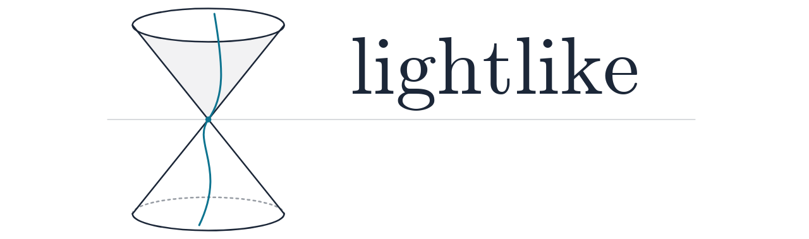

<p align="center"></p>

# Lightlike: formalized results and open problems in fundamental physics, in Lean 4

[](https://github.com/LightlikeProject/lightlike/actions/workflows/ci.yml)

Lean and Mathlib gave mathematics a machine-checked library, and much of the recent progress of AI
in mathematics builds on them. Lightlike aims to do the same for the mathematics of fundamental
physics: precise definitions, checked proofs, and open problems stated exactly. It is a Lean 4
library of research-level physics, built on
[Mathlib](https://github.com/leanprover-community/mathlib4) and
[Physlib](https://github.com/leanprover-community/physlib). So far it covers mostly spin-foam and
state-sum quantum gravity, and the general relativity, representation theory, PL topology and
Regge calculus they rest on: SU(2) recoupling and 6j symbols, the Ponzano–Regge and Turaev–Viro
models, Spin(4) and SL(2,ℂ) for spin foams, Lorentzian geometry and the Schwarzschild solution.
Other areas, from cosmology and black holes to holography and string theory, are on the
[roadmap](ROADMAP.md) as milestones open to contributors.

<!-- results:summary (generated by scripts/api_map.py) -->
The [catalog](docs/RESULTS.md) has 135 entries, each citing the source of its statement: 133 proven
results and 2 conditional results (proven under hypotheses that are named Lean propositions). Lean's
kernel has checked every proof. Statements are reviewed against their sources, since the kernel
cannot check that a statement matches its source. No entry has had expert human review yet, and a
review of any entry is welcome ([how to report a mismatch](#review)).
<!-- /results:summary -->

The plan has 220 tasks, on the [task board](docs/tasks/README.md): 10 **proof tasks**, which need
Lean but no physics, because the statement is fixed and only its proof is open; 187 **milestones**,
which add definitions and statements from the literature and need knowledge of their area; and 23
**upstream** tasks, which rework a result of Lightlike for Mathlib or Physlib.

Lightlike was developed privately over nine days, largely by AI coding agents working under
human direction, and is released as a clean snapshot of that work.

## Quick start

1. Build the library (see [Building](#building-and-using-lightlike)), or open it in a browser with
   [GitHub Codespaces](CONTRIBUTING.md#your-first-proof-task), with no local build.
2. Pick an issue labelled [**ready**](https://github.com/LightlikeProject/lightlike/issues?q=is%3Aissue+is%3Aopen+label%3Aready): everything the task needs is done.
3. Comment `claiming` on the issue, or `attempting` for a proof task.
4. Change the Lean files and run `lake build` (and `lake build Tasks` for a file in `Tasks/`).
5. Open a pull request with the line `Task: T-…`. It is merged when the CI hard rules pass
   ([CONTRIBUTING.md](CONTRIBUTING.md)).

## What Lightlike is

- **It is** a library of definitions, statements and proofs about the mathematics of physical
  models. Every result has a tier: **established** (standard mathematics and physics),
  **frontier** (published proposals) or **exploratory** (new or unpublished models). Exploratory
  work goes in `Exploratory/` folders, which the rest of the library may not import.
- **It is not** a claim that a model describes nature. A theorem says what follows from a model's
  definitions, under the hypotheses and limits stated with it.
- **It does not** prefer one approach to quantum gravity. Competing approaches sit side by side,
  each formalized from its own literature.

## Review

The kernel cannot check that a definition or a statement means what its source means, so each
statement is compared with its cited source for conventions (signature, units, normalisations),
quantifier ranges and hypotheses, junk values of partial operations (such as `ℕ` subtraction and
`x / 0 = 0`) and non-vacuity (an example satisfies the hypotheses of each main theorem).

A statement that passes is locked, and its proof becomes a proof task. Every entry of
[docs/RESULTS.md](docs/RESULTS.md) is **kernel-checked**; one that a domain expert has compared
with its source is marked **human-reviewed**, with a link to the issue that holds the review. To
review an entry, or to report a mismatch, open an [issue](https://github.com/LightlikeProject/lightlike/issues/new)
with the entry's ID, the place in its source, and what differs.

## How work is tracked

- **The repository holds the plan; the issues hold the progress.** A task's issue opens when the
  task becomes ready, and a workflow keeps its labels current from comments and pull requests:
  **ready**, **claimed**, **attempting**, **in review**. Nobody edits a status by hand.
- **Milestone and upstream tasks are taken by one person at a time.** Comment `claiming` to take
  one (you are assigned) and `stopping` to release it. Claims lapse after 14 days without activity.
- **Proof tasks are open to everyone at once.** Comment `attempting` to show that an attempt is in
  flight. The first proof that passes CI is merged.
- **Done means merged.** A pull request that finishes a task says `Closes #<issue>`; a proof task's
  issue is closed once its proof is on `main`. Tasks that need it then become ready.

## Documentation

- [docs/RESULTS.md](docs/RESULTS.md): the catalog, with each entry's Lean names, source and limits.
- [ROADMAP.md](ROADMAP.md): the topics in scope and their milestones.
- [Task board](docs/tasks/README.md): every task, by area, with its dependencies.
- [docs/CONVENTIONS.md](docs/CONVENTIONS.md): signature (−,+,+,+), doubled spins, units,
  normalisations, and the definitions taken from Physlib.
- API maps: `Lightlike/<Folder>/API-map.md`, the declarations of each folder.

## Relationship to other projects

Lightlike formalizes published results and states published open problems, each with its source;
outside the exploratory tier it proposes no new theories. It builds on Mathlib and Physlib: Physlib
covers mainstream physics, Lightlike research-level topics, quantum gravity first. General
mathematics belongs in Mathlib or [Tau Ceti](https://github.com/TauCetiProject/TauCeti); material
that fits Mathlib or Physlib is offered upstream ([the candidates](docs/tasks/README.md#upstream)).

Lean projects that overlap directly: [pachner](https://github.com/not-gary/pachner) (Cunningham,
Zach and Friedl, ITP 2026: simplicial complexes and stellar subdivisions, toward Pachner's theorem);
[OSforGFF](https://github.com/mrdouglasny/OSforGFF) ([Douglas et
al.](https://arxiv.org/abs/2603.15770): the 4D Gaussian free field and the Osterwalder–Schrader
axioms); [OSreconstruction](https://github.com/xiyin137/OSreconstruction) (the Osterwalder–Schrader
reconstruction theorem); [grlab](https://github.com/BrandonMYates/grlab) (curvature in coordinates
and exact solutions of Einstein's equations); and [aqft-lean](https://github.com/Deicyde/aqft-lean)
(algebraic quantum field theory, from pseudo-Riemannian geometry and Minkowski spacetime).

In the physics literature, the spin-foam and Regge parts follow two lines of work (IDs from the
[catalog](docs/RESULTS.md)). From covariant loop quantum gravity and its EPRL model ([Engle,
Pereira, Rovelli and Livine](https://arxiv.org/abs/0711.0146); review:
[Perez](https://arxiv.org/abs/1205.2019)): the EPRL map's equivariance, isometry and weak
simplicity (LL-0037), its injectivity on intertwiners (LL-0038), its action on coherent states and
the suppression of non-closing coherent intertwiners (LL-0039, LL-0040), and the finiteness of the
Lorentzian vertex ([Engle and Pereira](https://arxiv.org/abs/0805.4696); LL-0046). From Barrett and
collaborators: the large-spin formula of the Euclidean EPRL vertex ([Barrett, Dowdall, Fairbairn,
Gomes and Hellmann](https://arxiv.org/abs/0902.1170); LL-0047), the Barrett–Crane vertex (LL-0052),
the Ponzano–Regge model under Pachner moves ([Barrett and
Naish-Guzman](https://arxiv.org/abs/0803.3319); LL-0025, LL-0026) and area variables in Regge
calculus ([Barrett, Roček and Williams](https://arxiv.org/abs/gr-qc/9710056); LL-0058). Not covered
yet: the large-spin formula of the Lorentzian vertex ([Barrett, Dowdall, Fairbairn, Hellmann and
Pereira](https://arxiv.org/abs/0907.2440)) is in progress (task T-SF10), and no catalog entry
concerns an EPRL amplitude of more than one 4-simplex.

## Building and using Lightlike

Install Lean's version manager [elan](https://github.com/leanprover/elan) (see the [official
instructions](https://lean-lang.org/install/)). The versions are pinned: Lean and Mathlib `v4.35.0`,
Physlib at commit `cdfa609`. On Windows, install elan by those instructions, or run the commands
below in WSL, or use [Codespaces](CONTRIBUTING.md#your-first-proof-task). On Linux and macOS:

```sh
curl https://elan.lean-lang.org/elan-init.sh -sSf | sh
source "$HOME/.elan/env"
git clone https://github.com/LightlikeProject/lightlike && cd lightlike
lake exe cache get
lake build
lake build Tasks
```

`lake exe cache get` downloads Mathlib's prebuilt files; the first `lake build` compiles Physlib and
Lightlike, which took 28 min 34 s on GitHub's 4-core Linux runner and takes more than 90 minutes on a
2-core machine; later builds compile only what changed. A build needs about 11 GB of disk, and some
modules up to about 6 GB of RAM per Lean process (16 GB is recommended; 8 GB machines may build very
slowly). `lake build Tasks` builds the proof-task files in `Tasks/`, which are not part of the
library. The checks in `scripts/` need Python 3.9 to 3.14 and the packages in `requirements.txt`:
`python3 -m venv .venv && . .venv/bin/activate && pip install -r requirements.txt` (on Windows the
venv is activated with `.venv\Scripts\activate`; `scripts/gate.py` runs the CI steps with bash).

To use Lightlike in a project with the same Lean version, add to its `lakefile.toml`:

```toml
[[require]]
name = "lightlike"
git = "https://github.com/LightlikeProject/lightlike"
rev = "v0.1.0"
```

## Help wanted, community, license and citation

Lightlike has one maintainer. Help is especially welcome with repository and CI maintenance, Lean
infrastructure, domain review, and leading an area: open an issue labelled
[**help wanted**](https://github.com/LightlikeProject/lightlike/labels/help%20wanted). Discussion
and coordination on [Discord](https://discord.gg/Eyx3zTx9JW); questions and proposals in
[GitHub Discussions](https://github.com/LightlikeProject/lightlike/discussions). Everyone follows
the [code of conduct](CODE_OF_CONDUCT.md); contact: lightlike.project@gmail.com. Apache License 2.0,
copyright The Lightlike contributors ([LICENSE](LICENSE)); cite it via [CITATION.cff](CITATION.cff).
